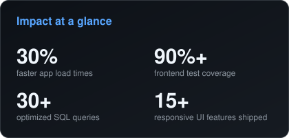
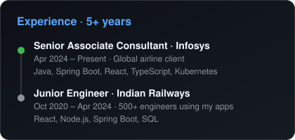
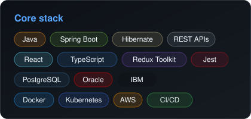

<h1 align="center">Rupesh Mahanta</h1>
<h3 align="center">Full-Stack Software Engineer · Java · Spring Boot · React · TypeScript</h3>

Bengaluru, India

  <a href="https://portfolio-three-beta-asubn6e94g.vercel.app/">Portfolio</a> ·
  <a href="https://www.linkedin.com/in/rupesh-mahanta">LinkedIn</a> ·
  <a href="https://www.youtube.com/@BuildWithRupesh">YouTube</a>

## About

Full-Stack Software Engineer with 5+ years of experience building enterprise applications with Java, Spring Boot, React and TypeScript. I work on a global airline client's platform at Infosys, covering REST services, microservices, IBM MQ integration, frontend delivery and production support.

- **Currently:** building enterprise applications at Infosys and side projects such as [Evenly](https://github.com/RupeshMahanta1994/Evenly), a group expense splitter built on a double-entry ledger
- **Learning:** system design, microservices and Kubernetes, shared on [BuildWithRupesh](https://www.youtube.com/@BuildWithRupesh)
- **Projects:** [portfolio-three-beta-asubn6e94g.vercel.app](https://portfolio-three-beta-asubn6e94g.vercel.app/)
- **Ask me about:** Java, Spring Boot, React, TypeScript and SQL

## Highlights

  
  
  

## Languages and Tools

